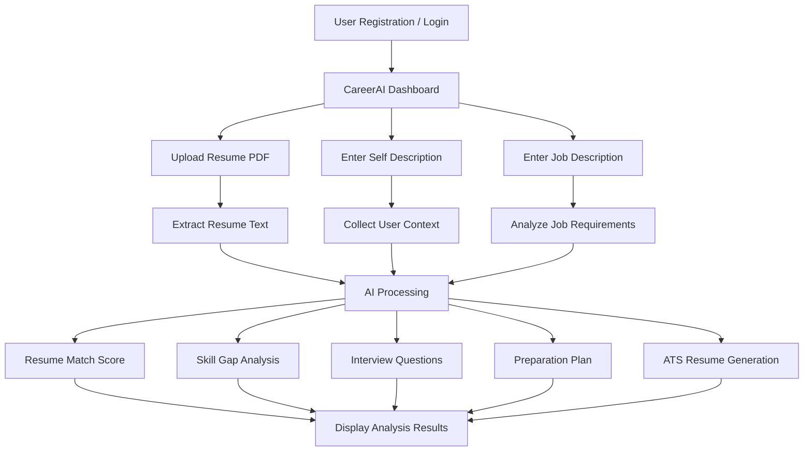
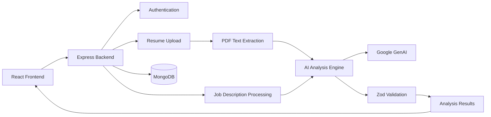

# 🚀 CareerAI – AI-Powered Resume Analyzer & Career Preparation Platform

CareerAI is an AI-powered career preparation platform designed to help students and job seekers improve their resumes, identify skill gaps, and prepare for job interviews.

The platform analyzes a user's resume against a target job description and generates personalized insights, including resume compatibility, missing skills, interview questions, and preparation recommendations.

The goal is to make job preparation smarter, more structured, and personalized using Artificial Intelligence.

---

## 🎯 Problem Statement

Many students and fresh graduates struggle with:

- Understanding whether their resume matches a job description.
- Identifying missing technical and professional skills.
- Creating ATS-friendly resumes.
- Preparing for technical and HR interviews.
- Knowing what to learn before applying for a particular job.

CareerAI aims to solve these problems through an AI-powered career preparation workflow.

## ✨ Key Features

### 📄 1. Resume Upload
- Upload an existing resume in PDF format.
- Extract resume content using PDF parsing.
- Process resume information for AI-based analysis.

### 🎯 2. Job Description Analysis
- Enter a target job description.
- Analyze the required skills and qualifications.
- Compare job requirements with the candidate's resume.

### 📊 3. Resume Match Score
- Generate a resume-job compatibility score.
- Identify relevant experience and skills.
- Highlight areas that need improvement.

### 🧠 4. Skill Gap Analysis
Identify skills based on job requirements and resume content.

The analysis can categorize skills into:
- Matching Skills
- Missing Skills
- Partially Matching Skills

This helps candidates understand what they need to improve.

### 🎤 5. AI Interview Preparation
Generate personalized interview questions based on:
- Resume information.
- Target job description.
- Technical skills.
- Professional experience.

The platform is designed to generate both technical and behavioral interview questions.

### 📚 6. Personalized Preparation Plan
Generate a structured learning roadmap based on identified skill gaps.

The preparation plan can include:
- Topics to study.
- Important technical concepts.
- Recommended learning priorities.
- Interview preparation tasks.

### 📝 7. AI Resume Generator
Generate an improved, ATS-friendly resume tailored to a target job description while preserving the candidate's actual qualifications and experience.

---

## 🔄 Application Workflow



## 🛠️ Technology Stack

### Frontend
- React.js
- Tailwind CSS
- JavaScript

### Backend
- Node.js
- Express.js
- REST APIs

### Database
- MongoDB

### Artificial Intelligence
- Google GenAI
- Large Language Models (LLMs)
- Prompt Engineering
- Structured AI Responses

### Document Processing
- PDF-Parse
- Multer

### Validation and Security
- Zod
- JWT Authentication
- Password Hashing

---

## 🏗️ System Architecture

CareerAI follows a client-server architecture.



## 📁 Project Structure

The following is an illustrative project structure. Adjust folder names to match your actual repository.

```text
CareerAI/
│
├── client/
│   ├── public/
│   ├── src/
│   │   ├── components/
│   │   ├── pages/
│   │   ├── dashboard/
│   │   ├── services/
│   │   └── App.jsx
│   └── package.json
│
├── server/
│   ├── controllers/
│   ├── routes/
│   ├── middleware/
│   ├── models/
│   ├── services/
│   ├── utils/
│   ├── server.js
│   └── package.json
│
├── .gitignore
└── README.md
```

## 🧠 AI Processing Pipeline

CareerAI uses an AI-driven workflow to analyze resumes and generate career recommendations.

**Step 1: Resume Extraction**

The uploaded PDF is processed using PDF parsing to extract readable resume content.

**Step 2: Job Description Processing**

The target job description is analyzed to identify important skills, qualifications, and responsibilities.

**Step 3: AI Analysis**

The extracted resume information and job requirements are provided to the Google GenAI model for analysis.

**Step 4: Structured Response**

Zod is used to validate and structure AI-generated responses according to the expected schema.

**Step 5: Result Generation**

The application processes the structured response and displays relevant insights on the dashboard.

## ⚙️ Installation and Setup

### Prerequisites

Make sure you have installed:

- Node.js
- npm
- MongoDB
- Git
- Google AI API Key

### 1. Clone the Repository

```bash
git clone YOUR_REPOSITORY_URL
cd CareerAI
```

### 2. Backend Setup

```bash
cd server
npm install
```

Create a `.env` file in the backend directory.

```env
PORT=5000

MONGO_URI=your_mongodb_connection_string

JWT_SECRET=your_jwt_secret

GOOGLE_API_KEY=your_google_ai_api_key
```

Configure any additional environment variables required by your implementation.

### 3. Start Backend

```bash
npm run dev
```

### 4. Frontend Setup

Open another terminal:

```bash
cd client
npm install
npm run dev
```

The frontend development server will provide a local URL in the terminal.

---

## 🔒 Security Considerations

- Secure authentication using JWT.
- Password hashing before database storage.
- Environment variables for API keys and secrets.
- Input validation using Zod.
- PDF upload handling using Multer.
- Server-side processing of sensitive AI credentials.

## 🔮 Future Enhancements

- AI-powered mock interview system.
- Interview answer evaluation and feedback.
- Resume version management.
- Multiple job application tracking.
- LinkedIn profile analysis.
- Job recommendation system.
- Learning resource recommendations.
- Resume export in PDF format.
- Advanced ATS optimization.
- Personalized career progress tracking.

---

## 👨‍💻 Author

**Bhaven Prajapat**

- GitHub: [GitHub Profile](https://github.com/)
- LinkedIn: [LinkedIn Profile](https://www.linkedin.com/in/bhaven-prajapat-a31295287/)

---

## ⭐ Support

If you find CareerAI interesting, consider giving the repository a star!

**Built with ❤️ using React, Node.js, and Generative AI.**
